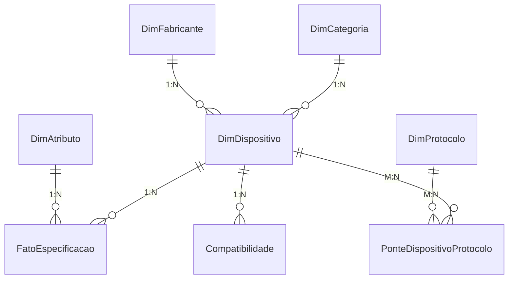

# 🚀 TECHDEX 1.0 — Enciclopédia Tecnológica Gamificada 100% Power BI


> **Explore. Compare. Descubra Tecnologia.**  
> Uma enciclopédia interativa inspirada no conceito de descoberta de uma Pokédex, dedicada integralmente a microcontroladores, placas de desenvolvimento, sensores, transceptores LoRa, dispositivos de conectividade e sistemas embarcados.

---

## 🎯 Visão Geral do Projeto

O **TECHDEX** é uma plataforma analítica e educacional desenvolvida integralmente no ecossistema **Power BI (PBIP / PBIR / TMDL / DAX)**, demonstrando que a ferramenta vai muito além de dashboards corporativos tradicionais de vendas ou finanças.

O projeto foi construído para servir como:
1. **Enciclopédia Técnica**: Catálogo de mais de 80 dispositivos reais com especificações documentadas e links diretos para datasheets oficiais.
2. **Arena de Comparação Técnica**: Ferramenta interativa de confronto lado a lado entre quaisquer dois dispositivos cadastrados com análise inteligente de diferenças.
3. **Laboratório de Compatibilidade**: Matriz determinística para identificação de compatibilidade elétrica, requisitos de conversão de nível lógico (3.3V vs 5V) e riscos elétricos.
4. **Radar do Ecossistema**: Visão de Business Intelligence sobre a distribuição de arquiteturas, memórias, frequências e protocolos de comunicação na indústria eletrônica.
5. **Central Educacional de Tecnologias**: Guias visuais e explicativos sobre protocolos seriais (UART vs SPI vs I2C), modulação LoRa vs LoRaWAN, modos de baixo consumo e arquiteturas de processamento.

---

## 📐 Estrutura das Páginas

O relatório contém **8 páginas principais** desenhadas em resolução nativa **1600 × 900 (16:9)** com paleta temática futurista escura:

- 🏠 **01 — TECHDEX Home**: Painel de boas-vindas com contadores dinâmicos, navegação por botões e cards de acesso rápido às 8 macrocategorias.
- 🔍 **02 — Explorador TECHDEX**: Catálogo navegável de hardware com filtros cruzados por categoria, fabricante, família, arquitetura e protocolo.
- 📋 **03 — Ficha Técnica do Dispositivo**: Exibição detalhada de cada componente com especificações de silício, limites elétricos, links diretos para datasheets e documentação oficial.
- ⚔️ **04 — Arena de Comparação**: Comparação técnica simultânea entre Dispositivo A e Dispositivo B utilizando tabelas desconectadas e medidas DAX avançadas.
- 📡 **05 — Radar Tecnológico**: Análise analítica da base, dispersão de frequência de clock versus memória RAM e matriz de compatibilidade de protocolos.
- ⚡ **06 — Laboratório de Compatibilidade**: Diagnóstico de acoplamento entre placas e sensores com alertas automáticos de tensão e condicionamentos elétricos.
- 📚 **07 — Guia de Tecnologias**: Central de consulta educacional sobre microcontroladores, barramentos industriais e conectividade sem fio.
- ℹ️ **08 — Sobre, Fontes e Metodologia**: Transparência editorial, créditos de fabricantes, metodologia de auditoria e controle de versões do catálogo.

---

## 🗄️ Modelo de Dados Semântico

O modelo semântico adota o padrão **Star Schema (Esquema Estrela)** com normalização **EAV (Entity-Attribute-Value)** para os parâmetros de hardware:



### Estatísticas da Base de Dados
- **Dispositivos Auditados**: 85 equipamentos de 8 categorias distintas.
- **Fabricantes Oficiais**: 26 indústrias de semicondutores e hardware (Espressif, ST, Arduino, Raspberry Pi, Semtech, Bosch, TI, Nordic, etc.).
- **Protocolos e Barramentos**: 19 tecnologias cabeadas e sem fio.
- **Relações de Especificação Fato**: 1.275 registros de engenharia auditados.

---

## 🛠️ Como Executar o Projeto

### Pré-requisitos
- **Power BI Desktop** (Versão 2.126+ com suporte a PBIP habilitado nas Opções e Configurações > Recursos de Visualização Prévia).

### Passos de Instalação
1. Clone este repositório:
   ```bash
   git clone https://github.com/luscaarmstrong1/techdex-powerbi.git
   ```
2. Abra o arquivo de projeto versionável:
   - Dê um duplo clique em `TECHDEX.pbip`.
3. Para salvar em arquivo único `.pbix`:
   - No Power BI Desktop, vá em `Arquivo > Salvar Como` e selecione o formato `Arquivo do Power BI (*.pbix)`.

---

## 🔄 Como Atualizar os Dados

Os dados estão centralizados em formato CSV na pasta `data/`:
- `data/dispositivos.csv`: Cadastro de novos componentes e placas.
- `data/especificacoes.csv`: Valores de clock, memória, GPIOs e limites de tensão.
- `data/compatibilidade.csv`: Regras determinísticas de acoplamento de sensores.

Após editar os arquivos locais, clique em **Atualizar (Refresh)** na guia Página Inicial do Power BI Desktop. Todas as consultas M e medidas DAX serão recalculadas automaticamente.

---

## 📄 Licenças e Atribuições
- O projeto de visualização, modelagem DAX, transformações Power Query e arquitetura dimensional é de autoria de **Lucas Silva**.
- Todos os nomes comerciais, marcas registradas e datasheets mencionados pertencem a seus respectivos fabricantes e proprietários intelectuais.
