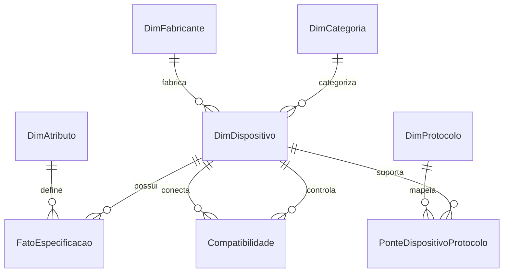

# TECHDEX 1.0 — Documentação de Arquitetura de Dados

## 1. Visão Geral da Arquitetura Dimensional

O projeto TECHDEX adota a metodologia de **Modelagem Dimensional Estrela (Star Schema)** combinada com padrão **EAV (Entity-Attribute-Value)** otimizado para especificações técnicas de alta heterogeneidade, evitando tabelas esparsas de centenas de colunas nulas.

### Diagrama Entidade-Relacionamento

---

## 2. Dicionário de Tabelas

### DimDispositivo
- **DeviceID** (PK): Chave estável padronizada no formato `TDX-XXXX`.
- **Nome**: Nome comercial amplamente reconhecido do componente ou placa.
- **Modelo**: Nomenclatura exata de fabricante / part number.
- **FabricanteID** (FK): Vínculo com a tabela de fabricantes.
- **CategoriaID** (FK): Vínculo com as 8 macrocategorias tecnológicas.
- **Subcategoria**: Classificação refinada de hardware.
- **Familia**: Agrupador de linhagem tecnológica (ex: ESP32, STM32F1, megaAVR).
- **DescricaoCurta**: Resumo objetivo em linguagem técnica direta.
- **DescricaoTecnica**: Detalhamento arquitetural, barramentos e controladores.
- **ImagemURL**: Endereço direto de fotografia de alta fidelidade do dispositivo.
- **DatasheetURL**: Link permanente para o PDF do datasheet oficial do fabricante.
- **DocumentacaoURL**: Portal de documentação oficial, SDKs e guias de início rápido.
- **StatusCicloVida**: Situação comprovada do ciclo de vida (Ativo, Maduro, Legado).
- **DataUltimaValidacao**: Timestamp da última auditoria técnica humana dos dados.

### DimCategoria
- **CategoriaID** (PK): Identificador numérico de 1 a 8.
- **Nome**: Rótulo da categoria.
- **Descricao**: Definição conceitual e fronteiras de escopo.
- **Cor**: Código hexadecimal exclusivo para identificação visual rápida na UI.
- **Icone**: Glifo vetorial representativo.
- **Ordem**: Prioridade de ordenação no menu e catálogo.

### DimAtributo & FatoEspecificacao
- Normaliza 15+ atributos técnicos (Clock, SRAM, Flash, Tensões mín/máx, Nível Lógico, GPIOs, ADC, DAC, Sleep Current e Temperaturas).
- Separa valores quantitativos em `ValorNumerico` (permitindo agregação, ordenação, min, max, avg e dispersão gráfica no DAX) de descrições textuais em `ValorTexto`.
- Rastreia rigorosamente a **CondicaoDeMedicao** comprovada em ensaios de datasheet (ex: temperatura de 25°C, clock nominal, RTC ativo).

### PonteDispositivoProtocolo & DimProtocolo
- Mapeia 19 barramentos e protocolos com cardinalidade muitos-para-muitos (M:N).
- Diferencia protocolos nativos de periféricos adicionais.
- Distingue com rigor técnico rádio físico LoRa de pilha de rede LoRaWAN, BLE de Bluetooth Clássico e Wi-Fi 4 de Wi-Fi 6.

### Compatibilidade
- Tabela de regras determinísticas de acoplamento entre dispositivos controladores e periféricos.
- Alerta sobre incompatibilidade de níveis lógicos (ex: pino ECHO de 5V do HC-SR04 danificando entradas de 3.3V do ESP32).
- Classifica o status em: **Compatível Documentado**, **Compatibilidade Condicionada**, **Não Comprovado** e **Incompatível**.
